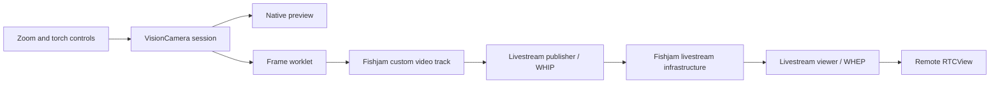

# How the camera integration works

The publisher uses one VisionCamera session for preview, zoom, torch, and the frames sent to Fishjam. Zoom changes captured pixels, so remote viewers see the same change. Torch control uses that session's camera controller.

## Publishing frames

[`useCameraSource`](../src/camera/core/useCameraSource.ts) connects VisionCamera to Fishjam through published APIs:

1. `useManagedForwardTrack` owns a native track and its stream.
2. `useLivestreamStreamer().connect` receives the managed stream as `inputs.video`, with a livestream streamer token.
3. A frame worklet obtains the native buffer and calls `forwardFrame` with its pointer and orientation correction.
4. Nested `finally` blocks release the buffer reference and dispose the frame, including when forwarding fails.

Fishjam retains the native buffer for encoding. Pixel data is never copied into JavaScript. The app needs no custom native module, library fork, or dependency patch.

[`useCaptureSession`](../src/camera/core/useCaptureSession.ts) configures the public VisionCamera session API with the frame output's 1280×720 target and 30 fps, without adding a screen-sized preview constraint. This prevents the preview from selecting oversized capture formats on iPhone. It serializes session creation, start/stop, and teardown during lens switches. Output orientation is fixed to the app's portrait interface.

The viewer uses `useLivestreamViewer().connect({ token })` with a separate viewer token. Its `stream` goes directly to [`RemoteStreams`](../src/room/RemoteStreams.tsx). Fullscreen playback reuses that stream and WHEP connection, with one renderer. Receivers use `contain`; the local preview uses `cover`.

[`useLivestreamSession`](../src/room/useLivestreamSession.ts) uses the Sandbox `/livestream` endpoint for private livestream creation/streamer credentials and `/{roomName}/livestream-viewer-token` for viewers. It waits for the SDK's connection state, handles its error field, and drains cancelled in-flight connections before retrying. The viewer never captures camera or microphone media. There is no conference join, peer list, or participant count.

The forwarding track lives above the keyed camera capture. Each camera session creates its own native frame output with `useCameraFrameOutput(source.track)`; sharing one output across sessions can stop delivery when the old session removes it. Switching cameras resets camera controls and the capture output but keeps the video track negotiated by WHIP. Backgrounding pauses capture and mutes audio while retaining the negotiated tracks; foregrounding can resume frames without creating a new publisher. An actual transport loss ends the session and asks the user to start again.

WHIP negotiates tracks when connecting. The publisher requests microphone access on **Go live** and passes a disabled audio track with the video. The microphone button toggles that track's `enabled` property, so it can unmute without renegotiation. If permission is denied, publishing proceeds without audio and explains how to enable it for a new session. Leaving or cancelling releases microphone capture; backgrounding mutes it and resume leaves it muted.

## Which runtime owns what?

| Runtime          | Responsibility                                                                                                           |
| ---------------- | ------------------------------------------------------------------------------------------------------------------------ |
| UI               | Pinch/button worklets, zoom calls, shared control values, labels, selected/disabled feedback, and the brightness slider. |
| Frame processing | Receive camera frames, forward native buffers, and release frame resources.                                              |
| React Native JS  | Camera/room lifecycle, configuration, panels, errors, confirmed hardware state, and the serialized torch command queue.  |

[`useCameraZoom`](../src/camera/core/useCameraZoom.ts) calls `camera.setZoom` from a UI worklet. Zoom lives in a shared value; an animated reaction forwards only changed errors to React. Relative zoom actions read the live value, so a pinch can enable a step button without waiting for a render.

[`useCameraTorch`](../src/camera/core/useCameraTorch.ts) updates requested strength on UI immediately. Only discrete hardware requests cross to JS. The slider, brightness label, and selected controls read the same value.

| State                    | Meaning                                                |
| ------------------------ | ------------------------------------------------------ |
| `liveZoom`               | Current zoom used by gestures and visible controls.    |
| `desiredTorchStrength`   | Latest requested torch strength; zero means off.       |
| `confirmedTorchEnabled`  | Whether the last confirmed hardware state is on.       |
| `confirmedTorchStrength` | Last confirmed nonzero strength, remembered while off. |

Actions ending in `OnUI` are worklets. Touch calls them on UI; accessibility schedules the same guarded actions from JS.

## Torch commands and capabilities

The camera reports whether it has a torch and supports adjustable strength. Presets respect its range, rounding to native integer steps on Android. Devices with only one usable brightness level get a direct circular on/off button. Devices without a torch get a disabled control.

[`cameraCommandQueue`](../src/camera/core/cameraCommandQueue.ts) serializes native requests and keeps the latest pending value. If hardware is busy while the user chooses 25%, 50%, and 75%, the queue can apply 25% followed by 75%. Intermediate completions do not move the selection backward. A final failure restores the confirmed state.

Session and request IDs reject stale callbacks. Cleanup turns the torch off after any pending enable completes. A resumed session waits for that cleanup before applying new requests.

## Stable preview and labels

Camera outputs stay stable across zoom and torch updates. [`CameraPreview`](../src/camera/CameraPreview.tsx) is memoized with stable output and gesture props, isolating the native preview from control renders.

[`CameraValueLabel`](../src/camera/CameraValueLabel.tsx) updates native text through animated props. Its memoized leaf prevents React renders from restoring stale text after a hardware confirmation. [`CameraControlButton`](../src/camera/CameraControlButton.tsx) uses UI worklets for taps, visual feedback, and accessibility state.

## Orientation and teardown

Two helpers deserve attention when upgrading VisionCamera:

- [`frameRotation`](../src/camera/core/frameRotation.ts) converts frame orientation into the clockwise correction WebRTC expects: left → 90°, right → 270°. On iOS, capture physically orients native buffers through AVFoundation, so upright frames need no WebRTC rotation. This avoids retained I420 rotation buffers observed in the pinned SDK's WHIP path. Android uses rotation metadata. Neither platform rotates pixels in JavaScript. The camera follows the portrait interface; local front-camera mirroring is a preview concern.
- [`useManagedFrameOutput`](../src/camera/core/useManagedFrameOutput.ts) detaches the native callback and keeps its runtime alive while queued native work drains. Its two queue barriers address a lifetime issue observed with VisionCamera 5.0.10 / CameraX 1.7.0-alpha01 and depend on that stack's queue ordering.

Keep both helpers when copying the integration. Recheck orientation, switching, background/resume, and unmount on physical devices after camera-stack upgrades. See the [testing guide](../TESTING.md).

## Local stream check

**Check** sends the custom track through two local native `RTCPeerConnection`s and renders the decoded image with frame statistics. It exercises capture, forwarding, encoding, and decoding without joining Fishjam.

It does not verify server signaling, authentication, SFU forwarding, or internet connectivity. Use the second-device viewer for those checks.

## References

- [Fishjam livestreaming tutorial](https://fishjam.swmansion.com/docs/tutorials/livestreaming)
- [Fishjam VisionCamera integration](https://fishjam.swmansion.com/docs/integrations/vision-camera/stream-vision-camera)
- [VisionCamera orientation](https://visioncamera.margelo.com/docs/orientation)
- [Nitro worklet support](https://nitro.margelo.com/docs/guides/worklets)
- [Reanimated performance guidance](https://docs.swmansion.com/react-native-reanimated/docs/guides/performance/)

[Back to the example](../README.md)
