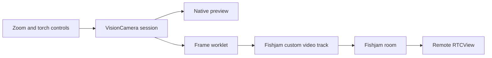

# How the camera integration works

The publisher uses one VisionCamera session for preview, zoom, torch, and the frames sent to Fishjam. Zoom changes captured pixels, so remote viewers see the same change. Torch control uses that session's camera controller.

## Publishing frames

[`useCameraSource`](../src/camera/core/useCameraSource.ts) connects VisionCamera to Fishjam through published APIs:

1. `useManagedForwardTrack` owns a native track and its stream.
2. `useCustomSource` registers the stream with Fishjam.
3. A frame worklet obtains the native buffer and calls `forwardFrame` with its pointer and orientation correction.
4. Nested `finally` blocks release the buffer reference and dispose the frame, including when forwarding fails.

Fishjam retains the native buffer for encoding. Pixel data is never copied into JavaScript. The app needs no custom native module, library fork, or dependency patch.

The viewer must read `peer.customVideoTracks`, not only `peer.cameraTrack`. [`RemoteStreams`](../src/room/RemoteStreams.tsx) supports both. Fullscreen playback reuses the existing stream and room connection, with one renderer for the selected track. Receivers use `contain`; the local preview uses `cover`.

## Which runtime owns what?

| Runtime          | Responsibility                                                                                                           |
| ---------------- | ------------------------------------------------------------------------------------------------------------------------ |
| UI               | Pinch/button worklets, zoom calls, shared control values, labels, selected/disabled feedback, and the brightness slider. |
| Frame processing | Receive camera frames, forward native buffers, and release frame resources.                                              |
| React Native JS  | Camera/room lifecycle, configuration, panels, errors, confirmed hardware state, and the serialized torch command queue.  |

[`useCameraZoom`](../src/camera/core/useCameraZoom.ts) calls `camera.setZoom` from a UI worklet. Zoom lives in a shared value; an animated reaction forwards only changed errors to React. Relative zoom actions read the live value, so a pinch can enable a step button without waiting for a render.

[`useCameraTorch`](../src/camera/core/useCameraTorch.ts) updates requested strength on UI immediately. Only discrete hardware requests cross to JS. The slider, brightness label, and selected controls read the same value.

| State                    | Meaning                                                |
| ------------------------ | ------------------------------------------------------ |
| `liveZoom`               | Current zoom used by gestures and visible controls.    |
| `desiredTorchStrength`   | Latest requested torch strength; zero means off.       |
| `confirmedTorchEnabled`  | Whether the last confirmed hardware state is on.       |
| `confirmedTorchStrength` | Last confirmed nonzero strength, remembered while off. |

Actions ending in `OnUI` are worklets. Touch calls them on UI; accessibility schedules the same guarded actions from JS.

## Torch commands and capabilities

The camera reports whether it has a torch and supports adjustable strength. Presets respect its range, rounding to native integer steps on Android. Devices with only one usable brightness level get a direct circular on/off button. Devices without a torch get a disabled control.

[`cameraCommandQueue`](../src/camera/core/cameraCommandQueue.ts) serializes native requests and keeps the latest pending value. If hardware is busy while the user chooses 25%, 50%, and 75%, the queue can apply 25% followed by 75%. Intermediate completions do not move the selection backward. A final failure restores the confirmed state.

Session and request IDs reject stale callbacks. Cleanup turns the torch off after any pending enable completes. A resumed session waits for that cleanup before applying new requests.

## Stable preview and labels

Camera outputs stay stable across zoom and torch updates. [`CameraPreview`](../src/camera/CameraPreview.tsx) is memoized with stable output and gesture props, isolating the native preview from control renders.

[`CameraValueLabel`](../src/camera/CameraValueLabel.tsx) updates native text through animated props. Its memoized leaf prevents React renders from restoring stale text after a hardware confirmation. [`CameraControlButton`](../src/camera/CameraControlButton.tsx) uses UI worklets for taps, visual feedback, and accessibility state.

## Orientation and teardown

Two helpers deserve attention when upgrading VisionCamera:

- [`frameRotation`](../src/camera/core/frameRotation.ts) converts frame orientation into the clockwise correction WebRTC expects: left → 90°, right → 270°. It passes metadata rather than rotating pixels in JavaScript. The camera follows the portrait interface; local front-camera mirroring is a preview concern.
- [`useManagedFrameOutput`](../src/camera/core/useManagedFrameOutput.ts) detaches the native callback and keeps its runtime alive while queued native work drains. Its two queue barriers address a lifetime issue observed with VisionCamera 5.0.10 / CameraX 1.7.0-alpha01 and depend on that stack's queue ordering.

Keep both helpers when copying the integration. Recheck orientation, switching, background/resume, and unmount on physical devices after camera-stack upgrades. See the [testing guide](../TESTING.md).

## Local stream check

**Check** sends the custom track through two local native `RTCPeerConnection`s and renders the decoded image with frame statistics. It exercises capture, forwarding, encoding, and decoding without joining Fishjam.

It does not verify server signaling, authentication, SFU forwarding, or internet connectivity. Use the second-device viewer for those checks.

## References

- [Fishjam VisionCamera integration](https://fishjam.swmansion.com/docs/integrations/vision-camera/stream-vision-camera)
- [VisionCamera orientation](https://visioncamera.margelo.com/docs/orientation)
- [Nitro worklet support](https://nitro.margelo.com/docs/guides/worklets)
- [Reanimated performance guidance](https://docs.swmansion.com/react-native-reanimated/docs/guides/performance/)

[Back to the example](../README.md)
