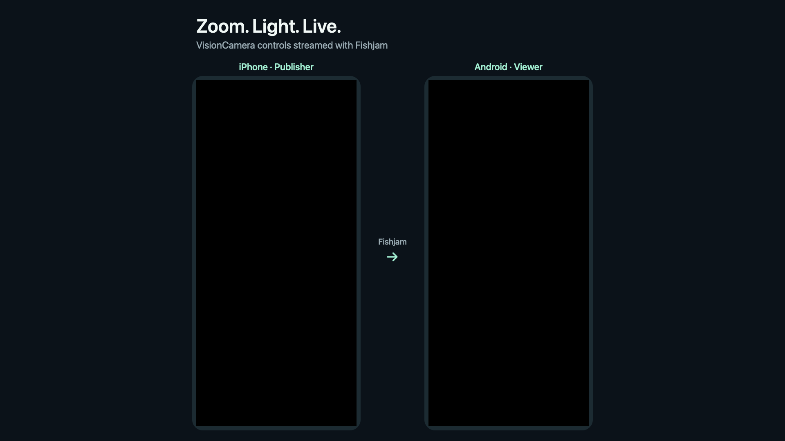

# Record the camera demo

The prepared scene is 1920×1080: **iPhone · Publisher** on the left, **Android · Viewer** on the right. It keeps each complete portrait screen visible. You operate the physical phone yourself.



## Get both devices ready

1. Connect the iPhone to the Mac by USB and leave it unlocked. Open this app on both devices.
2. Use the same Fishjam room and different participant names. On Android, choose **Join as a viewer**, then **Join as viewer**. On the iPhone, choose **Open studio**, then **Go live**.
3. Wait until Android shows the actual received camera picture. Tap the video or its expand button to watch fullscreen. Leave the microphone off for a silent demonstration.
4. Aim the iPhone at a stationary object with detail or printed text. Keep the phone steady; a moderately dim scene makes the torch easier to demonstrate. Keep both apps in portrait throughout the take.

QuickTime has already been tested with the connected iPhone. Open **File → New Movie Recording**, open the menu beside Record, and select the connected iPhone under **Screen** (some macOS versions label this **Camera**). The preview must show the phone's screen, rather than a Mac webcam. Select the iPhone's audio source if needed; the final composition intentionally omits audio. See [Apple's device recording guide](https://support.apple.com/guide/quicktime-player/record-a-movie-qtp356b55534/mac).

## Simplest live recording

Place QuickTime's iPhone preview and the Android emulator side by side. Move the pointer away so QuickTime's controls disappear. Press **Shift–Command–5**, choose **Record Selected Portion**, frame both windows and record. Stop with **Control–Command–Escape**. This records both views on one timeline, without manual synchronization. See [Apple's screen recording guide](https://support.apple.com/102618).

The Mac screen recording contains the window arrangement you choose. For the labeled scene shown above, record the two clean device feeds and use the compositor below.

## Record clean device feeds

Create a fresh folder for each take, from the project root:

```sh
mkdir -p artifacts/demo/take-01
```

In QuickTime, start recording the iPhone. Then start Android capture in a terminal:

```sh
adb devices
# Substitute the intended serial if yours differs.
adb -s emulator-5556 shell screenrecord \
  --size 720x1606 --bit-rate 12000000 --time-limit 75 \
  /sdcard/fishjam-take-01.mp4
adb -s emulator-5556 pull /sdcard/fishjam-take-01.mp4 artifacts/demo/take-01/android.mp4
```

`720×1606` was verified on the current `1280×2856` emulator. Its full display resolution exceeds the encoder's supported size. For another emulator, choose a supported size with the same portrait aspect ratio. Keep the viewer receiving moving video: a completely static screen can produce only one frame, with no useful duration.

Wait a few seconds before your first camera action. After the take, stop QuickTime and save it as `artifacts/demo/take-01/iphone.mov`. The Android command stops after 75 seconds and then pulls the video. Keep the originals for editing. Use a new folder and device filename for each take.

A useful 45–60 second sequence:

| Moment  | Action                                                        |
| ------- | ------------------------------------------------------------- |
| Opening | Hold the scene at 1× with torch Off.                          |
| Zoom    | Tap 2×, pause, then slowly pinch in and out.                  |
| Reset   | Return to 1× and hold the phone still.                        |
| Torch   | Open Light; show 25%, 50%, 75%, then 100%, pausing at each.   |
| Finish  | Drag down to Off, close the panel and hold the final picture. |

Let each result remain visible for a few seconds on Android. Do not use the local **Check** preview for this take; the Android viewer is showing the Fishjam stream.

## Export the prepared scene

Requires `ffmpeg` and `ffprobe` on PATH (both are already available on the Mac used for setup). Run from the project root:

```sh
npm run demo:compose -- \
  --iphone artifacts/demo/take-01/iphone.mov \
  --android artifacts/demo/take-01/android.mp4 \
  --output artifacts/demo/take-01/side-by-side.mp4
```

This creates a silent **1920×1080, 30 fps H.264 MP4** and `side-by-side-preview.png`. Neither source is changed. Existing output files are never overwritten. The video ends with the shorter trimmed source.

Separate recordings start at different times. Use `--iphone-start SECONDS` and `--android-start SECONDS` to trim their beginnings to the same recording time. For example, if iPhone capture began about two seconds before Android, start with `--iphone-start 2`. Fine-tune using your recording start times or a simultaneous external reference. **Do not align the zoom/torch effect in the publisher with its later arrival on the viewer**: that would remove the actual stream delay. Manually aligned clips are a feature demo, not a latency measurement. Use the single Mac screen recording when one shared capture timeline matters.

Use a new output filename when adjusting offsets:

```sh
npm run demo:compose -- \
  --iphone artifacts/demo/take-01/iphone.mov \
  --android artifacts/demo/take-01/android.mp4 \
  --iphone-start 2 --android-start 0 \
  --output artifacts/demo/take-01/side-by-side-aligned.mp4
```

The backdrop is checked in as `scene.png`. On macOS, regenerate it with `swift scripts/render-demo-scene.swift` from the repository root. Its slot coordinates match `scripts/compose-demo.mjs`; update both together if changing the layout.

The repository's [showcase video](../media/demo.mp4) uses a single desktop recording of the iPhone publisher and Android viewer. Both device screens were cropped into this scene on the same timeline, preserving their actual relative timing. See [showcase media](../media/README.md).
